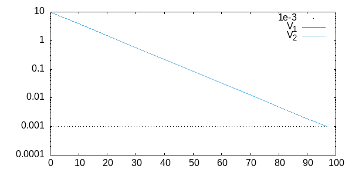
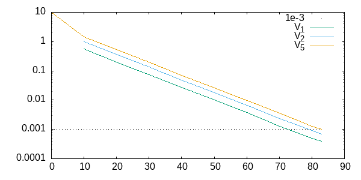
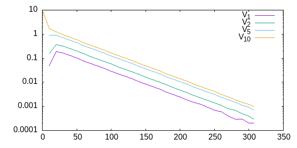
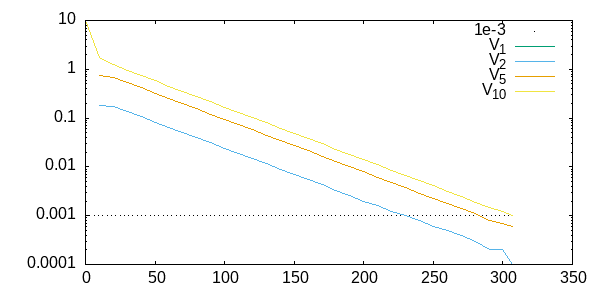
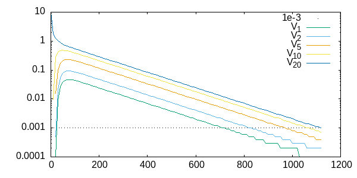
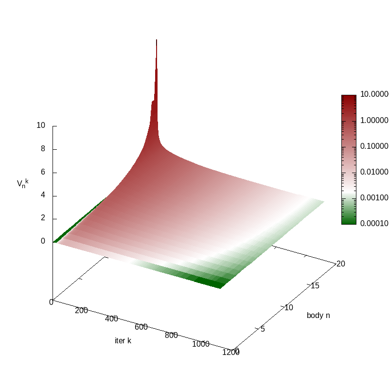
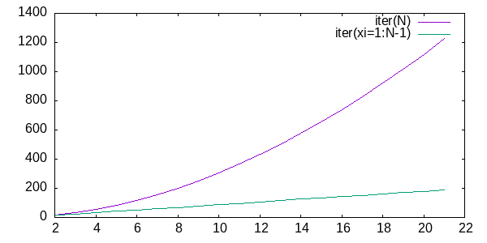

#+STARTUP: indent overview
#+title: Multiple simultaneous collisions
#+date: <2026-10-12 lun>
#+author: Oscar

See [[file:02_sequential.org]]

SUMMARY: Simple IMPACT case N bodies with var mass ratio, still
Equalities, no time-stepping or warmstarting, just instant collision
* Problem

We want to solve a perfectly inelastic impact of a rigid body $N$ on a
stack of $N+1$ bodies, where body $0$ is the static ground and bodies
$1..N$ are dynamic.

Sign convention: Positive velocities go UP, from i to i+1 (opposite
from ABC example before)

TODO: Diagram

the pre-collision initial conditions are:
\[ V_{0..N-1}^{(0)} = 0 ,\quad V_N^{(0)} < 0 \]

Collisions introduce the following inequality constraints on
post-collision relative velocities, with $V_{ij}=V_i-V_j$.

\[ C_{i+1,i} = V_{i+1}^* - V_{i}^* \geq 0 \]

For any magnitude, a superindex $^{(0)}$ indicates pre-collision
initial condition, and $^*$ indicates post-collision global
solution.

Masses are arbitrary, but we'll assume $1/m_0 = 0$ and $m_{i} \leq m_{i+1}$.

** Solution

Similar to the restricted problem (TODO LINK), the intuitive *global
solution* for post-collision velocities is
\[V_{i}^* = 0 ,\quad i \in [0,N] \]

* Sequential Impulses
** Local Response

Contact constraint is a "gap function" $G_{a,b} = p_a-p_b \geq 0$,
deriving results in constraints on post-impact velocities $V_i^+$

\[ C_{i+1,i} = V_{i+1}^+ - V_{i}^+ \geq 0 \]

Instantaneous *local* impulses from $C_{i+1,i}$
\[ V_i^+ = V_i^- - \frac{1}{m_i} \lambda_{i+1,i} \]
\[ V_{i+1}^+ = V_{i+1}^- + \frac{1}{m_{i+1}} \lambda_{i+1,i} \]

Collision impulses must only push objects apart, so $\lambda \geq 0$.

we assume body 0 has infinite mass, so $1/m_0 = 0$
\[ V_0^+ = V_0^- = 0 \]

** Iterative solution

Each iteration $k$ we'll solve C_i in order

* Numeric solution
** Impact stack 2 bodies with $\xi=10$

This is the same as PART1, but implemented generically, same results,
97 iter to converge below $\epsilon$

#+NAME: table-stack2-T1-mr10-v10-eps1e3
#+BEGIN_SRC C++ :includes <stdio.h> :results drawer :noweb strip-export :exports results
  <<GSimulateStack1D>>
  int main( int argc, char** argv )
  {
      const int K(1000);
      GSimulateStack1D<3>( 10.0f, //\xi
                           10.0f, //V0
                           0.0f, //G
                           1, 0.0f, //T, dt
                           1e-3f, //\epsilon
                           K, //K iter per step T
                           true, //bBottomToTop
                           false, //bWarmstart
                           1.0f, //ws_decay01
                           true ); //bPrintAsOrgTable
      return 0;
  }
#+END_SRC

#+NAME: image-stack2-T1-mr10-v10-eps1e3
#+BEGIN_SRC gnuplot :var data=table-stack2-T1-mr10-v10-eps1e3 :file ../img/sequential-image-stack2-T1-mr10-v10-eps1e3.png :exports results
  set term png size 600, 300
  set size ratio 0.5
  set yrange [1e-4:10]
  set logscale y
  plot 1e-3 with dots lc 'black', \
       data u 2:4 title "V_1" with lines, \
       data u 2:5 title "V_2" with lines
  unset yrange
  unset logscale
#+END_SRC

#+RESULTS: image-stack2-T1-mr10-v10-eps1e3

** Impact stack 5 bodies with $\xi=1$

#+NAME: table-stack5-T1-mr1-v10-eps1e3-b2t
#+BEGIN_SRC C++ :includes <stdio.h> :results drawer :noweb strip-export :exports results
  <<GSimulateStack1D>>
  int main( int argc, char** argv )
  {
      const int K(1500);
      GSimulateStack1D<6>( 1.0f, //\xi
                           10.0f, //V0
                           0.0f, //G
                           1, 0.0f, //T, dt
                           1e-3f, //\epsilon
                           K, //K iter per step T
                           true, //bottom-to-top
                           false, //bWarmstart
                           1.0f, //ws_decay01
                           true ); //bPrintAsOrgTable
      return 0;
  }
#+END_SRC

#+NAME: image-stack5-T1-mr1-v10-eps1e3-b2t
#+BEGIN_SRC gnuplot :var data=table-stack5-T1-mr1-v10-eps1e3-b2t :file ../img/sequential-image-stack5-T1-mr1-v10-eps1e3-b2t.png :exports results
  set term png size 600, 300
  set size ratio 0.5
  set yrange [1e-4:10]
  set logscale y
  plot 1e-3 with dots lc 'black', \
       data u 2:4 title "V_1" with lines, \
       data u 2:5 title "V_2" with lines, \
       data u 2:8 title "V_5" with lines
  unset yrange
  unset logscale
#+END_SRC

#+RESULTS: image-stack5-T1-mr1-v10-eps1e3-b2t

** Impact stack 10 bodies with $\xi=1$

Solving in bottom-to-top order

#+NAME: table-stack10-T1-mr1-v10-eps1e3-b2t
#+BEGIN_SRC C++ :includes <stdio.h> :results drawer :noweb strip-export :exports results
  <<GSimulateStack1D>>
  int main( int argc, char** argv )
  {
      const int K(500);
      GSimulateStack1D<11>( 1.0f, //\xi
                            10.0f, //V0
                            0.0f, //G
                            1, 0.0f, //T, dt
                            1e-3f, //\epsilon
                            K, //K iter per step T
                            true, //bottom-to-top
                            false, //bWarmstart
                            1.0f, //ws_decay01
                            true ); //bPrintAsOrgTable
      return 0;
  }
#+END_SRC

#+NAME: image-stack10-T1-mr1-v10-eps1e3-b2t
#+BEGIN_SRC gnuplot :var data=table-stack10-T1-mr1-v10-eps1e3-b2t :file ../img/sequential-image-stack10-T1-mr1-v10-eps1e3-b2t.png :exports results
  set term png size 600, 300
  set size ratio 0.5
  set yrange [1e-4:10]
  set logscale y
  plot 1e-3 with dots lc 'black', \
       data u 2:4 title "V_1" with lines, \
       data u 2:5 title "V_2" with lines, \
       data u 2:8 title "V_5" with lines, \
       data u 2:13 title "V_{10}" with lines
  unset yrange
  unset logscale
#+END_SRC

#+RESULTS: image-stack10-T1-mr1-v10-eps1e3-b2t

Solving in top-to-bottom order, similar iter count, but different
convergence curves

#+NAME: table-stack10-T1-mr1-v10-eps1e3-t2b
#+BEGIN_SRC C++ :includes <stdio.h> :results drawer :noweb strip-export :exports results
  <<GSimulateStack1D>>
  int main( int argc, char** argv )
  {
      const int K(500);
      GSimulateStack1D<11>( 1.0f, //\xi
                            10.0f, //V0
                            0.0f, //G
                            1, 0.0f, //T, dt
                            1e-3f, //\epsilon
                            K, //K iter per step T
                            false, //bottom-to-top
                            false, //bWarmstart
                            1.0f, //ws_decay01
                            true ); //bPrintAsOrgTable
      return 0;
  }
#+END_SRC

#+NAME: image-stack10-T1-mr1-v10-eps1e3-t2b
#+BEGIN_SRC gnuplot :var data=table-stack10-T1-mr1-v10-eps1e3-t2b :file ../img/sequential-image-stack10-T1-mr1-v10-eps1e3-t2b.png :exports results
  set term png size 600, 300
  set size ratio 0.5
  set yrange [1e-4:10]
  set logscale y
  plot 1e-3 with dots lc 'black', \
       data u 2:4 title "V_1" with lines, \
       data u 2:5 title "V_2" with lines, \
       data u 2:8 title "V_5" with lines, \
       data u 2:13 title "V_{10}" with lines
  unset yrange
  unset logscale
#+END_SRC

#+RESULTS: image-stack10-T1-mr1-v10-eps1e3-t2b

** Impact stack 20 bodies with $\xi=1$

#+NAME: table-stack20-T1-mr1-v10-eps1e3-b2t
#+BEGIN_SRC C++ :includes <stdio.h> :results drawer :noweb strip-export :exports results
  <<GSimulateStack1D>>
  int main( int argc, char** argv )
  {
      const int K(2000);
      GSimulateStack1D<21>( 1.0f, //\xi
                            10.0f, //V0
                            0.0f, //G
                            1, 0.0f, //T, dt
                            1e-3f, //\epsilon
                            K, //K iter per step T
                            true, //bottom-to-top
                            false, //bWarmstart
                            1.0f, //ws_decay01
                            true ); //bPrintAsOrgTable
      return 0;
  }
#+END_SRC

#+NAME: image-stack20-T1-mr1-v10-eps1e3-b2t
#+BEGIN_SRC gnuplot :var data=table-stack20-T1-mr1-v10-eps1e3-b2t :file ../img/sequential-image-stack20-T1-mr1-v10-eps1e3-b2t.png :exports results
  set term png size 600, 300
  set size ratio 0.5
  set yrange [1e-4:10]
  set logscale y
  plot 1e-3 with dots lc 'black', \
       data u 2:4 title "V_1" with lines, \
       data u 2:5 title "V_2" with lines, \
       data u 2:8 title "V_5" with lines, \
       data u 2:13 title "V_{10}" with lines, \
       data u 2:23 title "V_{20}" with lines
  unset yrange
  unset logscale
#+END_SRC

#+RESULTS: image-stack20-T1-mr1-v10-eps1e3-b2t

** TODO Plot(n,k) $V_n^k$ as surface to see convergence wrt N,K

#+NAME: sequential_splot_Vnk
#+BEGIN_SRC C++ :includes <stdio.h> :results file :file sequential_splot_Vnk.txt :noweb strip-export :exports results
  <<GSimulateStack1D>>
  int main( int argc, char** argv )
  {
      const int K(20000);
      GSimulateStack1D<21>( 1.0f, //\xi
                            10.0f, //V0
                            0.0f, //G
                            1, 0.0f, //T, dt
                            1e-3f, //\epsilon
                            K, //K iter per step T
                            true, //bottom-to-top
                            false, //bWarmstart
                            1.0f, //ws_decay01
                            false ); //bPrintAsOrgTable, false to splot as matrix
      return 0;
  }
#+END_SRC

#+RESULTS: sequential_splot_Vnk
[[file:sequential_splot_Vnk.txt]]

#+BEGIN_SRC gnuplot :file ../img/sequential_splot_Vnk.png :exports results
  set term png size 800, 800
  set size ratio 0.5
  set xlabel 'iter k'
  set ylabel 'body n'
  set zlabel 'V_n^k'
  #set logscale z
  set logscale cb #logarithmic palette to highlight error near 0
  # Palette = red->white error, green=converged, range is [0,1] for zrange [min,max]
  set palette defined (0 "dark-green", 0.25 "white", 1 "dark-red")
  splot 'sequential_splot_Vnk.txt' matrix u 2:1:3 title '' with pm3d #x(1) col, y(2) row, z(3) value
  unset zrange
  unset logscale
  set palette #reset to default palette
  unset xlabel
  unset ylabel
  unset zlabel
#+END_SRC

#+RESULTS:

*** TODO DRAFT and REFS                                          :noexport:
Eix vertical es body n in eix horitzontal es iter k in K
F(x,y) es vel d’aquell body en aquella iter

Hauria de sortir superficie que tendeix a 0 amb k per tots els bodies, pero bN es el que mes tarda

Pot revelar estructura, i es facil de puntar usant dades existents per n,k

Tall vertical/horitzontal haurien de mostrar com “convergeix” en cada
eix

- See https://gnuplotting.org/tag/colormap/
- See http://gnuplot.info/docs_4.2/node332.html#matrix_ascii

** Table iter wrt N                                               :noexport:
No point in exporting table, it was manualy generated, so keep
explicit and tag with noexport

last colum is 2 bodies with $\xi=1:N-1$

#+CAPTION: iter count per N bodies
#+ATTR_HTML: :width 50%
#+NAME: table-iter-per-N
| N bodies | Mass ratio | iter(N) | iter(2) |
|        2 |        1:1 |      14 |      14 |
|        3 |        1:2 |      31 |      23 |
|        4 |        1:3 |      54 |      33 |
|        5 |        1:4 |      83 |      42 |
|        6 |        1:5 |     117 |      51 |
|        7 |        1:6 |     157 |      60 |
|        8 |        1:7 |     202 |      69 |
|        9 |        1:8 |     252 |      79 |
|       10 |        1:9 |     307 |      88 |
|       11 |       1:10 |     367 |      97 |
|       12 |       1:11 |     432 |     106 |
|       13 |       1:12 |     502 |     116 |
|       14 |       1:13 |     576 |     125 |
|       15 |       1:14 |     655 |     134 |
|       16 |       1:15 |     739 |     143 |
|       17 |       1:16 |     827 |     152 |
|       18 |       1:17 |     920 |     162 |
|       19 |       1:18 |    1018 |     171 |
|       20 |       1:19 |    1119 |     180 |
|       21 |       1:20 |    1225 |     189 |

Extra rows, not plotted but keep quadratic shape
|       51 |       1:50 |    6295 |     466 |
|      101 |      1:100 |   21863 |     926 |
** Plot iter(N) and iter($\xi$)

#+NAME: plot-iter-per-N
#+BEGIN_SRC gnuplot :var data=table-iter-per-N :results file :file ../img/plot-iter-per-N.png :exports results
  plot data u 1:3 title 'iter(N)' with lines, \
       data u 1:4 title 'iter(xi=1:N-1)' with lines
#+END_SRC

#+RESULTS: plot-iter-per-N

So iter count seems to grow linearly with body count $N$, and also
linearly with mass ratio $1:N-1$ (analogous to 2-body $\xi$), so
combined iter count grows *quadratically* with $N \xi = N(N-1)$.

Computational cost grows *cubically* with $N$, as per iter is linear
in $N$, and we need $N^2$ iter.

TODO this is not clear, finish [[Analytic convergence]] first before
drawing any conclusions

** Implementation of GSimulateStack1D                             :noexport:
NOTE:, func uses printf but include "<stdio.h>" must be added to caller
main() block due to how org-babel tangles multiple code blocks.

NOTE: To call it from other blocks, use "noweb" syntax
<<GSimulateStack1D>>, that inserts func definition into any block
(even if defined earlier). Use ":noweb strip-export" in caller block
to avoid inserting code verbatim and exporting the <<src>> text.
(see https://orgmode.org/manual/Noweb-Reference-Syntax.html)

TODO CODE assumes vel down are POSITIVE, so Vab is negated wrt eq
above, consider reconciling code convention with the "genaral case"
with positive-up

TODO IMPLEMENT with LAMBDAS not with VEL, assume m1=1

TODO Flag steps that end with any negative speed in red (maybe output
column so that gnuplot can just plot green/red)

TODO PARAM to support inequalities and make it a full PGS or just GS

#+NAME: GSimulateStack1D
#+BEGIN_SRC C++ :includes <stdio.h> :exports none
  template <unsigned int N>
  void GSimulateStack1D( float xi, float V0, float G, //massratio, vel, grav
                         int T, float dt, //steps and timestep
                         float epsilon, int K, //precision and iterations
                         bool bBottomToTop, //solve from bottom to top
                         bool bWarmstart, float ws_decay01, //warmstarting
                         bool bPrintAsOrgTable ) //Org-Table or plain matrix Iter(k) x Body(n)
  {
      const float wa(xi/(xi+1));
      float V[N] = {}; V[N-1] = V0;
      float cached_Vab[N] = {};
      if( bPrintAsOrgTable ) //table header
      {
          printf("t k");
          for( int n=0; n<N; n++ )
              printf(" V[%d]", n);
      }
      int tk(0); //total iter across timesteps
      for( int t=0; t<T; t++ ) //T frames
      {
          // Integrate t->t+dt
          for( int n=1; n<N; n++ )
              V[n] += dt*G;
          int k(0); //per-step iter

          // TODO Apply warmstarting, but only after contacts applied
          // their 2nd impulse, not 1st (persisted for >1 steps, save on
          // 2nd step, apply on 3rd)
          if( bWarmstart && t>1 )
          {
              for( int n=1; n<N; n++ )
              {
                  float wa_n( n==1 ? 0.0f : wa ); //B[0] is static
                  V[n-1] -= cached_Vab[n] * wa_n;
                  V[n] += cached_Vab[n] * (1-wa_n);
                  cached_Vab[n] *= ws_decay01;
              }
          }
          // Solve/refine constraints after warmstarting
          while( k < K && V[N-1] > epsilon )
          {
              if( k%10 == 0 || !bPrintAsOrgTable ) //TEMP: no skip unless table, add skip count param instead
              {
                  if( bPrintAsOrgTable )
                      printf("\n%d %d",t,tk);
                  else
                      printf("\n");
                  for( int n=0; n<N; n++ )
                      printf(" %2.4f",V[n]);
              }
              //Solve N-1 constraints b2t or t2b
              {
                  V[0] = 0.0f;
                  for( int n=1; n<N; n++ )
                  {
                      const int c( bBottomToTop ? n : N-n ); //constraint index

                      float Vab( V[c-1] - V[c] ); //solve AB
                      float wa_n( c==1 ? 0.0f : wa ); //B[0] is static
                      // req separating contact (TODO not sure if correct,
                      // we should clamp total not per-iter)
                      if( Vab > 0.0f )
                          Vab = 0.0f;

                      V[c-1] -= Vab * wa_n;
                      V[c] += Vab * (1-wa_n);

                      // Update warmstarting after 1st step
                      if( bWarmstart && t>0 )
                          cached_Vab[c] += Vab;
                  }
              }
              k++;
              tk++;
          }
          // V[i] for last iter k in current timestep t
          if( bPrintAsOrgTable )
              printf("\n%d %d",t,tk);
          else
              printf("\n");
          for( int n=0; n<N; n++ )
              printf(" %2.4f",V[n]);
      }
  }
#+END_SRC

* TODO [#B] Analytic convergence

TODO: Try to derive convergence for N>2 bodies, is there a similar
recurrence for V_n^k?? MAY NOT BE POSSIBLE

Write recurrence for body V_N depending on V_N-1...V_0 per iter

Deterime iter count to converge with N objects, does it grows more
than linearly?

FROM Numeric results, convergence rate is the same as with 2 bodies
and mass ratio, error decreases exponentially, fast first, slow so log
error plot is linear.

TODO try to isolate role of object count and mass ratio, because if
they're mixed, increasing obj count also increases mr for bottommost
object vs everything above

The convergence problem is not limited to large mass ratios between
individual bodies, it can also appear when multiple light bodies
impact another one simultaneously with coherent velocity (ex: a stack
of N bricks falling on a single one, or avalanche of similar rocks
forming a pile of rubble), in that case the bottommost object needs to
absorb the momentum of all other objects, so object count is
essentially the same as the mass ratio of a simplified problem where
N-1 objects have been merged into one.

recurrencia
\[ V_n^k = V_n^{k-1} + V_{n,n-1}^{k-1} w_{n,n-1} \]
\[ V_{n-1}^k = V_{n-1}^{k-1} + V_{n-1,n-2}^{k-1} w_{n-1,n-2} \]

Assume $w_{n,n-1}$ is constant $w$, except for n=1 that is 1

Later expand w wrt $\xi$ but initially no need

** Hypothesis

For 2 bodies:
\[ V_b^{k} = V_b^{(0)} w^k\]
\[ k^* \approx -\log(\epsilon/V_b^{(0)}) (\xi+1)\]

For N bodies
Assume $V_N^{k} = V_N^{(0)} w^{\frac{k}{(N-1)}}$
TODO NOT CORRECT DOES NOT MATCH table results

This seems reasonable but does not match:
\[ k^* \approx -\log(\epsilon/V_b^{(0)}) (\xi+1) N^2\]

Best match is something like this, but not sure why, accurate for N=[2,100]
\[ k^* \approx -\log(\epsilon/V_b^{(0)}) (0.25) (N+2)^2\]
Which could be, for $w=0.5$, so maybe try for different w?
\[ k^* \approx -\log(\epsilon/V_b^{(0)}) (w(N+2))^2\]

w = (1-0.5*1/n-1)

#+NAME: image-vN_k
#+BEGIN_SRC gnuplot :file ../img/sequential_vN_k.png :exports results
  set term png size 600, 300
  set size ratio 0.5
  #set xrange [1:1200]
  #set yrange [0:0.01]
  #plot 1e-3 with dots lc 'black', \
  #     10*(0.5**(x/(4*(10-1)))) title "V_b(k), N=10" with lines, \
  #     10*(0.5**(x/(4*(20-1)))) title "V_b(k), N=20" with lines
  #plot 1e-3 with dots lc 'black', \
  #     10*(1-0.5/(10-1))**x title "V_b(k), N=10" with lines, \
  #     10*(1-0.5/(20-1))**x title "V_b(k), N=20" with lines
  set xrange [0:21]
  plot -log((1e-3)/10) * (0.25) * (x+2)**2 with lines title 'best match up to 100', \
       -log((1e-3)/10) * (x+1) with lines
  unset xrange
  unset yrange
#+END_SRC

#+RESULTS: image-vN_k
[[file:../img/sequential_vN_k.png]]

** Condition Number of direct system should be $w^N$ or similar if this is true
- For constant masses, cond number of direct linear system should grow
  with both w and N, or at least show that eigenvalues go from w to
  w^N? MUST be related to recurrence, IIRC this was connected through
  the characteristic polynomial of the recurrence, likely same as the
  poly for the eigenvalue problem

** TODO Prove this somehow

How would N bodies converge, depending on masses I think if known
solution is Vi=0 for all, we can always partition a list of bodies
{Bi} to Wall, A (sandwiched), B=sum Bi fir all other bodies, and
assume they behave like a single block, so mass ratio mA, mB increases
with Bi count even if individual bodies have constant mass. This makes
sense I think and would reuse the same derivation. We’re computing how
long it takes to converge at the “bottleneck” body A due to mass B,
regardless of number of bodies in Bi set

MAY depend on solve order, if top-to-bottom, I think num bodies is the
same as mass ratio, but if not then it takes longer to converge

* LOCAL VARIABLES                                                  :noexport:
Local Variables:
org-confirm-babel-evaluate: nil
End:
